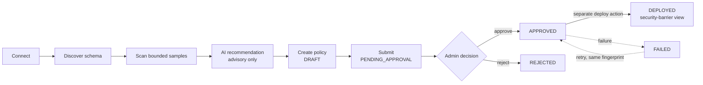
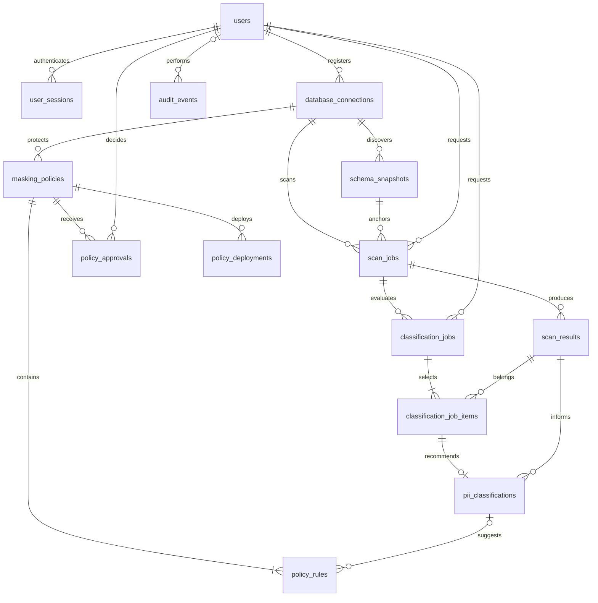
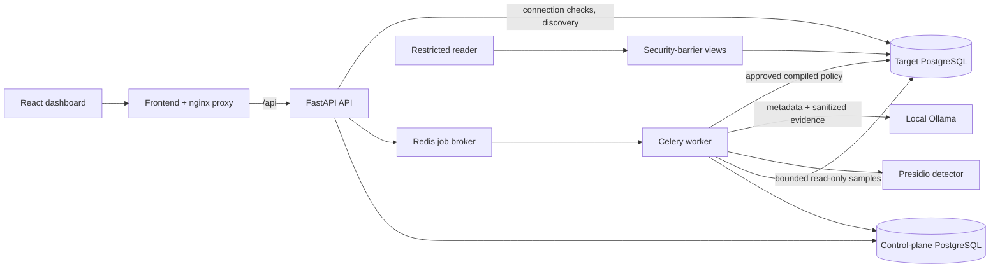

# PrivacyShield

**A PostgreSQL privacy platform that discovers sensitive data, recommends protection, and deploys human-approved masking as security-barrier views, without ever modifying the source data.**


> Built as a **Database Management Systems (DBMS)** project. The database is the centre of the design: normalized schema, constraint-enforced integrity, role-based access control, views as the protection mechanism, and explicit transaction boundaries.

---

## Table of contents

1. [What it does](#what-it-does)
2. [DBMS concepts demonstrated](#dbms-concepts-demonstrated)
3. [How it works](#how-it-works)
4. [Database design](#database-design)
5. [Masking as SQL views](#masking-as-sql-views)
6. [Roles and permissions](#roles-and-permissions)
7. [Transactions and concurrency](#transactions-and-concurrency)
8. [Architecture](#architecture)
9. [Quick start](#quick-start)
10. [Verification](#verification)
11. [Documentation index](#documentation-index)
12. [Security notes and limitations](#security-notes-and-limitations)

---

## What it does

Organizations keep personal data (emails, phone numbers, PAN and Aadhaar numbers, card and account numbers) in relational databases, and analysts, support staff and developers often need to query those databases without seeing the raw values. PrivacyShield automates the workflow:

| Step | What happens |
| --- | --- |
| **1. Connect** | Register a PostgreSQL database. Credentials are stored encrypted and password inputs are write-only. |
| **2. Discover** | Read the catalog and capture an immutable, fingerprinted **schema snapshot** (tables, columns, relationships). |
| **3. Scan** | An asynchronous job reads a **bounded, read-only sample** and runs Presidio-based detection to find PII *candidates*. |
| **4. Recommend** | A **local** AI model (Ollama) proposes a category, risk and protection action per column. It is advisory only: it sees metadata and sanitized evidence, never raw rows, and cannot execute SQL. |
| **5. Approve** | A person builds a masking policy. A versioned policy is **immutable** once submitted, and an administrator approves a specific version. |
| **6. Deploy** | A separate, explicit action compiles the policy to predefined SQL templates and creates a **security-barrier view**. Readers query only the view. |
| **7. Audit** | Every significant action is written to an append-only, hash-chained audit trail. |

All seven phases are delivered and each passed local acceptance and GitHub delivery verification. See [`docs/roadmap.md`](docs/roadmap.md) and [`docs/verification-phase7.md`](docs/verification-phase7.md).

---

## DBMS concepts demonstrated

| Concept | Where it appears in this project |
| --- | --- |
| **ER modelling** | A 20-relationship ER diagram of the control-plane schema ([below](#database-design)). |
| **Normalization** | Users, connections, scans, classifications and policies are separate facts with independent lifecycles. Requesters are referenced by foreign key rather than repeated as names or emails. Rules and approvals are separate rows tied to an exact policy version. |
| **Integrity constraints** | Primary keys (UUID), foreign keys, `UNIQUE`, and `CHECK` constraints for roles and states, positive sample limits, non-negative counts, and bounded confidence and progress. |
| **Composite foreign keys** | `scan_jobs(snapshot_id, connection_id)` references `schema_snapshots(id, connection_id)`, so PostgreSQL rejects a scan that uses another connection's snapshot even if both rows exist. The same technique ties classification items to the scan they belong to. |
| **Indexing** | Foreign-key indexes for joins, job status and time indexes for polling and recovery, and timestamp and actor indexes for review history. |
| **Views** | Masking is implemented as `security_barrier` views that expose only the approved projection. |
| **Access control (DCL)** | Six purpose-built database roles with least privilege, including a `NOLOGIN` view-owner role and a reader with no base-table access. |
| **Transactions** | Approval, audit write and status change commit atomically under a row lock. Deployment uses a target advisory lock and a single target transaction. |
| **Idempotency and recovery** | Unique deployment idempotency keys, durable job state in PostgreSQL, and reconciliation against a target-side receipt after uncertain outcomes. |
| **Semi-structured data** | `JSONB` is used only for immutable catalog snapshots, bounded sanitized evidence and event details. It never replaces relational ownership, status, identity or approval columns. |
| **Schema versioning** | Alembic migrations are the single schema authority; `create_all()` is never used for upgrades. |
| **Tamper evidence** | An insert-only `audit_chain` table hashes each audit event together with the previous hash. See [`docs/audit-chain.md`](docs/audit-chain.md). |

---

## How it works



Roles in the application: **`ADMIN`** can approve, reject and deploy; **`ANALYST`** can create and submit policies; **`AUDITOR`** is read-only.

---

## Database design

PrivacyShield uses **two separate PostgreSQL databases**:

- **Control plane**: normalized metadata and sanitized evidence. It is never a copy of customer data.
- **Target**: the database being protected. The bundled target contains **synthetic** customer, account, transaction and support data only.

### Control-plane ER diagram



### Tables

| Table | Purpose and key integrity rules |
| --- | --- |
| `users` | Unique normalized email, password hash (Argon2), constrained role, active flag |
| `user_sessions` | User FK, unique **hashed** token (plaintext tokens are never stored), expiry and revocation |
| `database_connections` | Unique name, endpoint config, encrypted scanner and deployer credentials |
| `schema_snapshots` | Connection FK, immutable catalog content, fingerprint, discovery time |
| `scan_jobs` | Connection, snapshot and requester FKs, bounded sample size, state and progress |
| `scan_results` | Job FK, column or JSON path, non-negative counts, bounded confidence, sanitized evidence |
| `classification_jobs` | Completed-scan FK, 1 to 50 selected results, constrained status, model and prompt version |
| `classification_job_items` | Composite job/result identity, same-scan foreign keys, per-item state |
| `pii_classifications` | Unique job/result pair, category, risk, action, confidence, approval-required flag |
| `masking_policies` | Connection, table and version identity, lifecycle state, source and plan fingerprints |
| `policy_rules` | One explicit decision per column per audience (`reader`, `support`, `analyst`), unique per policy, column and audience |
| `policy_approvals` | Policy and deciding-user FKs, decision, timestamp |
| `policy_deployments` | Policy FK, **unique idempotency key**, execution state, target receipt |
| `audit_events` | Optional actor FK, event type, subject, timestamp, correlation ID, sanitized details |
| `audit_chain` | Insert-only hash chain over `audit_events` |

Design choices worth noting:

- **UUID primary keys** give stable identities independent of display names. Timestamps are timezone-aware UTC.
- **History is retained.** Users and connections are deactivated rather than deleted, so scan, policy and audit history survive.
- **Plaintext credentials and raw PII are prohibited** in every column, including `JSONB` evidence and audit details.

Full rationale, indexes and normalization notes: [`docs/database-design.md`](docs/database-design.md).

---

## Masking as SQL views

A policy is an immutable, per-column decision set for one table. Deployment compiles it into **one** `CREATE OR REPLACE VIEW ... WITH (security_barrier = true)` statement. Columns without a rule become a typed `NULL`, so the column list stays stable but nothing leaks.

| Action | Compiled SQL | Result |
| --- | --- | --- |
| `KEEP` | `"col" AS "col"` | Pass-through, type preserved |
| `REDACT` | `CASE WHEN "col" IS NULL THEN NULL ELSE '[REDACTED]' END` | `[REDACTED]` |
| `PARTIAL` | `... '***' \|\| right("col"::text, 4)` | `***1234` |
| `MASK_EMAIL` | first character plus `***@` plus host | `c***@example.com` |
| `MASK_PHONE` | all digits but the last four replaced by `*` | `+** ***** *0001` |
| `MASK_ID` | all letters and digits but the last four replaced by `*` | `**** **** 0001` |
| `PSEUDONYMIZE` | `encode(hmac(col, key, 'sha256'), 'hex')` | Deterministic keyed token |
| `NULLIFY` / `RESTRICT` | `NULL::<type>` | No value exposed |

Illustrative shape of a generated view (the real name is `<table>_<digest>`, bounded to 63 bytes):

```sql
CREATE OR REPLACE VIEW public.customers_a1b2c3 WITH (security_barrier = true) AS
SELECT
    "id"                                                                   AS "id",
    CASE WHEN "full_name" IS NULL THEN NULL ELSE '[REDACTED]' END          AS "full_name",
    CASE WHEN "card_no"   IS NULL THEN NULL
         ELSE '***' || right("card_no"::text, 4) END                       AS "card_no",
    NULL::text                                                             AS "notes"
FROM public.customers;
```

Safety properties:

- **Fail-closed masks.** If a value does not have the expected shape (free text in an email column, say), it is replaced entirely with `***` rather than partially shown.
- **Plan fingerprint.** A SHA-256 over the source identity, view identity and ordered column decisions is stored at approval and re-derived at deployment. A mismatch blocks deployment as schema or content drift.
- **Injection-safe compilation.** Identifiers and data types are validated before interpolation, and pseudonym domains must match `^[a-z0-9_]{1,60}$`.
- **Preview before deploy.** The policy preview runs the compiled expressions over fabricated example values, so no source row is read.

Details: [`docs/masking.md`](docs/masking.md) and [`docs/masking-audiences.md`](docs/masking-audiences.md).

---

## Roles and permissions

| Database | Role | Responsibility |
| --- | --- | --- |
| Control | `ps_migrator` | Schema ownership and migration DDL |
| Control | `ps_app` | Runtime CRUD as granted; append-only audit writes |
| Target | `ps_scanner` | Read authorized tables; **no writes** |
| Target | `ps_deployer` | Restricted privacy-infrastructure deployment; not a superuser |
| Target | `ps_view_owner` | `NOLOGIN` owner of masked views |
| Target | `ps_reader` | `SELECT` on approved views only; **no base-table access** |

Runtime grants deny `UPDATE`, `DELETE` and `TRUNCATE` on `audit_events`. This protects against mutation by the application, not against a malicious database administrator.

---

## Transactions and concurrency

- **Job creation and its audit record commit together.** Queued delivery can be retried without creating duplicate work.
- **Approval locks the policy row** and records the decision and audit event in one transaction. A concurrent decision on an already-transitioned version returns `409`.
- **Deployment is idempotent.** It has a durable, unique idempotency key and at most one active attempt per policy. A target-side advisory lock serializes related changes.
- **Source revalidation, view creation, grants and the receipt share one target transaction.**
- **Two databases cannot share one atomic transaction.** After an uncertain outcome (such as a network error after commit), the system reads the target receipt and reconciles control-plane state. A network error is never treated as proof of rollback.

---

## Architecture



The backend is a FastAPI modular monolith shared by the API and Celery processes. PostgreSQL is the source of truth for job state; Redis carries only job identifiers.

| Directory | Responsibility |
| --- | --- |
| `backend/` | FastAPI, SQLAlchemy models, Alembic migrations, workers, tests |
| `frontend/` | React, TypeScript, routes, dashboard, reverse proxy, UI tests |
| `infra/` | PostgreSQL role provisioning and synthetic source fixtures |
| `scripts/` | Local secret setup and verification |
| `docs/` | Architecture, database design, roadmap, operations |

More detail: [`docs/architecture.md`](docs/architecture.md).

---

## Quick start

**Prerequisites:** Git, Python 3.12, and Docker Desktop running Linux containers. No native Node or PostgreSQL install is needed for the Docker setup.

```bash
git clone https://github.com/Taarunkarthik/PRIVACY-SHIELD.git
cd PRIVACY-SHIELD
git switch dev/privacyshield

python scripts/setup.py              # generates local secrets into an ignored .env
docker compose up --build -d --wait
docker compose ps
```

Create the first administrator once the API is healthy (you will be prompted for a password; there is **no default password**):

```bash
docker compose exec api python -m app.cli create-admin --email admin@example.com
```

Then open **http://localhost:8080**.

### One-command demo

With the stack running and an administrator account created, `python scripts/demo.py` walks the full workflow in one step: it registers the synthetic target, runs a bounded scan, then creates, approves and deploys a masking policy, and prints a compact before/after summary of the masked columns. It needs the same prerequisites as the other scripts in `scripts/`.

Optional local AI recommendations: enable the `ai` Compose profile to run Ollama.

**Hosted option:** a Render Blueprint (`render.yaml`) deploys the full stack. See [`docs/deploy-render.md`](docs/deploy-render.md).

> Never commit `.env` or paste its contents into tickets, logs or chat. `.env.example` documents configuration with placeholders only.

---

## Verification

With the Compose services running:

```bash
python scripts/check.py --integration
```

This validates Compose, lints and tests the backend, migrates a separate `privacyshield_test` database, exercises real PostgreSQL, Redis and Celery, and checks actual scanner and reader permissions. Add `--frontend` (requires Node 24) to include type checking, UI tests and a production build.

Development outside containers:

```bash
cd backend
uv sync --locked --extra dev
uv run ruff check .
uv run pytest -m "not integration"

cd ../frontend
npm ci && npm run typecheck && npm test && npm run build
```

Integration tests require migrated PostgreSQL, Redis and a **separate** Linux Celery worker. A mocked broker does not satisfy that gate. The [GitHub Actions workflow](.github/workflows/ci.yml) provisions the same real services in CI.

Per-phase evidence: [`docs/verification.md`](docs/verification.md) and `docs/verification-phase2.md` through `docs/verification-phase7.md`; the pre-submission hardening pass is recorded in [`docs/verification-hardening.md`](docs/verification-hardening.md).

---

## Documentation index

| Topic | Document |
| --- | --- |
| Architecture and trust boundaries | [`docs/architecture.md`](docs/architecture.md) |
| Database design, ER diagram, transactions | [`docs/database-design.md`](docs/database-design.md) |
| Delivery roadmap and phase gates | [`docs/roadmap.md`](docs/roadmap.md) |
| Connection and discovery | [`docs/discovery.md`](docs/discovery.md) |
| Bounded PII scanning | [`docs/scanning.md`](docs/scanning.md) |
| Local AI classification | [`docs/classification.md`](docs/classification.md) |
| Masking policies and deployment | [`docs/masking.md`](docs/masking.md) |
| Audit hash chain | [`docs/audit-chain.md`](docs/audit-chain.md) |
| Render deployment | [`docs/deploy-render.md`](docs/deploy-render.md) |
| Operations and troubleshooting | [`docs/operations.md`](docs/operations.md) |

---

## Security notes and limitations

- Use only databases you are **authorized** to inspect. The bundled target is synthetic.
- PAN and Aadhaar detection identifies **candidates**, not verified identities. Findings describe bounded samples, not full-table coverage.
- AI output is advisory, is validated against enumerated categories and actually discovered columns, and cannot execute SQL. The AI test double checks orchestration and failure handling; it does not establish real model quality.
- Raw samples, keys and credentials must not appear in logs, task payloads, AI input or committed files.
- The default configuration supports a **local demonstration**. Before exposing it beyond localhost, terminate TLS and enable secure cookies with explicit allowed origins. This is not a production deployment or a compliance certification.
- Deployment onto source tables that use row-level security is deferred; read-only scanning still respects existing RLS.

---

## Author

**Taarun**, B.Tech Computer Science Engineering, Amrita Bangalore. Built for DBMS coursework.

Released under the [MIT License](LICENSE); see [`SECURITY.md`](SECURITY.md) for how to report a vulnerability.
