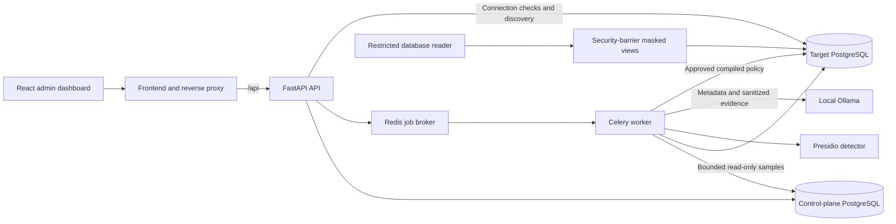

# Architecture

## Deployment topology

PrivacyShield uses one backend codebase with separate HTTP and background-worker processes. The target database is physically separate from the control-plane database. The Docker deployment defaults to localhost access through the frontend reverse proxy.

The full diagram is the delivery target. Phase 1 implements authentication, dashboard summary, the databases and their role boundaries, migrations, and real worker smoke execution. Presidio scanning, Ollama classification, and policy deployment are gated by later phases.

| Service | Responsibility | Default host exposure |
| --- | --- | --- |
| `frontend` | React assets and `/api` reverse proxy | `127.0.0.1:8080` |
| `api` | Authentication, RBAC, validated APIs, orchestration | None |
| `worker` | Shared backend logic in a Linux Celery process | None |
| `control-db` | Durable metadata, sessions, and audit records | None |
| `target-db` | Separate synthetic enterprise data | None |
| `redis` | Job delivery and worker result transport | None |
| `ollama` | Local model inference in optional `ai` profile | None |

The one-shot `migrate` service applies control-plane migrations. PostgreSQL entrypoint scripts provision roles and synthetic target data only when their respective data volumes are first initialized. The optional `ollama-pull` service downloads the configured model. Successful initialization and service health checks gate dependent startup. PostgreSQL, rather than Redis, will be the source of truth for scan and deployment state.

## Trust boundaries

- The browser receives session identity, sanitized metadata, and summaries. It never receives stored database passwords or raw source samples.
- API and worker use the `ps_app` control-plane runtime role. Migration ownership belongs to `ps_migrator`; runtime application credentials cannot alter the schema or rewrite audit history.
- The target `ps_scanner` role can inspect authorized tables and read bounded samples. Its database grants prohibit inserts, updates, deletes, and DDL.
- The target `ps_deployer` role operates only within provisioned privacy infrastructure and uses explicitly granted privileges. It is not a database superuser.
- `ps_view_owner` is a `NOLOGIN` role for approved view ownership. `ps_reader` can read approved views but cannot read underlying business tables.
- Ollama receives only verified schema metadata and sanitized evidence. All responses require independent validation against enumerated categories, actions, and actual discovered columns.

Before exposing a deployment beyond localhost, terminate TLS and enable secure cookies with explicit allowed origins. The default configuration supports a local demonstration; it does not constitute a production deployment or certification of compliance.

## Application interface

All routes are prefixed `/api/v1`. Phase 1 includes:

| Endpoint | Behavior |
| --- | --- |
| `GET /health/live` | Process liveness |
| `GET /health/ready` | Required database and Redis readiness |
| `POST /auth/login` | Validate credentials and establish a server-side session |
| `GET /auth/me` | Return identity and CSRF token for a valid session |
| `POST /auth/logout` | Revoke the session; requires CSRF token |
| `GET /dashboard/summary` | Authenticated counts from durable metadata |

Passwords use Argon2 hashes. The browser session cookie is HttpOnly; unsafe authenticated requests include `X-CSRF-Token`. Session expiry and revocation are enforced on the server. Supported roles are `ADMIN`, `ANALYST`, and `AUDITOR`; privileged write workflows will be restricted to administrators.

Later phases add connection/discovery, asynchronous scans, validated classification, versioned policy actions, deployments, and audit/settings APIs. Queued work returns `202` with a durable identifier. Conflicting state or stale versions return `409`. List APIs use pagination. Error responses must redact credentials and source values.

## Policy deployment design

This section defines later-phase behavior, not Phase 1 functionality:

1. Discover and fingerprint the source schema; scan bounded read-only samples.
2. Validate advisory classifications and build a policy from allowlisted actions.
3. Compile a complete explicit projection. Columns without an approved decision become typed `NULL`; sensitive JSONB and free text initially use whole-column nullification or restriction.
4. Review and submit an immutable policy version. Administrator approval and deployment are separate actions, even when performed by the same administrator.
5. Lock the deployment, recheck the schema and privileges, and execute predefined SQL in a target transaction. Record an idempotent receipt in that transaction.
6. Reconcile the target receipt with durable control-plane state. A response lost after target commit must not be misreported as a rolled-back deployment.

Views use `security_barrier` and explicit columns. Restricted readers must not inherit base-table privileges. Source rows, primary keys, and foreign keys remain unchanged. HMAC pseudonymization returns text and shares a protected key/domain when related columns need matching pseudonyms. Deployment onto source tables with RLS is deferred; read-only scanning still respects existing RLS.
