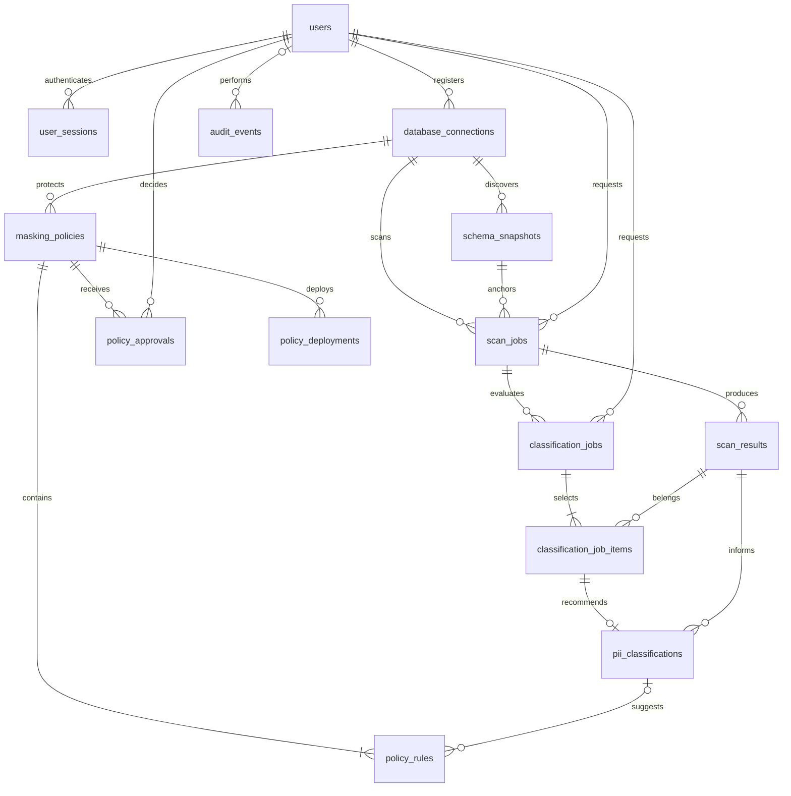

# Control-plane database design

The control plane contains normalized metadata and sanitized evidence. It never serves as a copy of the customer database. Target rows live in a separate PostgreSQL service.

## Entity relationships



## Tables and constraints

The foundation migration establishes these entities. Their presence does not mean every associated workflow is implemented.

| Table | Purpose and principal integrity rules |
| --- | --- |
| `users` | Unique normalized email, password hash, constrained role, active flag |
| `user_sessions` | User FK, unique hashed bearer token, expiration/revocation; plaintext session tokens are not stored |
| `database_connections` | Unique name, endpoint configuration, encrypted scanner/deployer credentials, creator FK |
| `schema_snapshots` | Connection FK, immutable catalog content, fingerprint, discovery timestamp |
| `scan_jobs` | Connection/snapshot/requester FKs, bounded sample setting, state/progress |
| `scan_results` | Job FK, column or JSON path, nonnegative sampled/detection counts, bounded confidence, sanitized evidence |
| `classification_jobs` | Completed scan/requester FKs, 1–50 selected results, constrained status/progress/counts, model/prompt version, bounded attempts |
| `classification_job_items` | Composite job/result identity, same-scan foreign keys, per-result completion/failure state |
| `pii_classifications` | Unique job/result pair, category/risk/action, confidence, bounded explanation, model/prompt version, required approval flag |
| `masking_policies` | Connection/table/version identity, lifecycle state, source and compiled-plan fingerprints |
| `policy_rules` | Policy FK, explicit per-column protection decision for one audience (`reader`, `support` or `analyst`; unique per policy, column and audience), optional classification FK |
| `policy_approvals` | Policy and deciding-user FKs, decision, timestamp |
| `policy_deployments` | Policy FK, unique idempotency key, execution state, target receipt |
| `audit_events` | Optional actor FK, event type, subject, timestamp, correlation identifier, sanitized details |
| `audit_chain` | Insert-only hash chain over `audit_events`: dense index, event reference, previous hash, row hash. See [audit-chain.md](audit-chain.md) |

UUID primary keys provide stable identities independent of display names. Timestamps use timezone-aware UTC storage. Foreign keys connect business entities; uniqueness prevents duplicate emails, names, tokens, policy versions, rules for the same column and audience, and deployment idempotency keys where applicable. Database checks constrain roles/states, positive sample limits, nonnegative counts, and confidence/progress bounds.

`schema_snapshots` additionally has a unique `(id, connection_id)` pair, referenced by the composite foreign key on `scan_jobs(snapshot_id, connection_id)`. PostgreSQL therefore rejects a scan that uses another connection's snapshot, even when both referenced records independently exist.

Classification selection is normalized into `classification_job_items`; composite foreign keys require the selected result and classification job to belong to the same scan. An accepted recommendation must reference that exact selected pair. Each item commits independently so a model outage preserves earlier accepted recommendations and deterministic scan findings. The job reports `PARTIAL` rather than implying that incomplete work succeeded.

Foreign-key indexes support joins. Job status/time indexes support polling and recovery. Approval and audit timestamp/actor indexes support review history without scanning the entire audit table. Migrations remain the versioned schema authority: never rely on `create_all()` for deployment upgrades.

## Normalization decisions

Users, connections, scans, classifications, and policies represent separate facts with independent lifecycles. A job's requester is a user reference rather than a repeated name/email. Results reference jobs instead of duplicating endpoint credentials. Classifications reference results so model output and deterministic observations remain distinguishable. Rules and approval decisions are separate rows associated with an exact policy version.

JSONB is limited to immutable external catalog snapshots, bounded sanitized evidence, and event details. It is not a substitute for relational ownership, status, identity, or approval columns. This avoids update anomalies while retaining the varying shape of source schemas and redacted evidence.

Historical records are retained. Deactivate users and connections instead of deleting associated scan, policy, or audit history. Plaintext credentials and raw PII are prohibited in JSONB evidence and audit fields just as they are in ordinary columns.

## Roles and permissions

| Database | Role | Responsibility |
| --- | --- | --- |
| Control | `ps_migrator` | Schema ownership and migration DDL |
| Control | `ps_app` | Runtime CRUD as granted; append-only audit writes |
| Target | `ps_scanner` | Read authorized synthetic/business tables; no source writes |
| Target | `ps_deployer` | Restricted privacy infrastructure deployment |
| Target | `ps_view_owner` | `NOLOGIN` ownership of masked views with required source access |
| Target | `ps_reader` | Select approved views only; no base-table access |

Control runtime grants deny `UPDATE`, `DELETE`, and `TRUNCATE` on `audit_events`. Owners can administratively alter data; this boundary protects against runtime application mutation, not a malicious database administrator. Target role membership, inherited grants, schema privileges, and existing object grants must be checked before any later policy deployment is accepted.

## Transactions and concurrency

Phase 1 login/session/audit changes use the control database transaction. Schema migrations run under the migration role before API startup.

The following are requirements for later workflow phases:

- Job creation and its audit record commit together; queued delivery can be retried without creating duplicate business work.
- Policy submission freezes the submitted content. An edit creates another policy version.
- Approval or rejection locks the policy row and records the decision plus audit event in one transaction. Concurrent decisions against an already transitioned version return `409`.
- Deployment has a durable, unique idempotency key and at most one active attempt per policy. A target advisory lock serializes related changes.
- Source revalidation, view deployment, grants, and receipt creation share one target transaction.
- Control and target databases do not share an atomic transaction. Reconciliation reads the target receipt after uncertain outcomes, then updates control-plane state. A network error is not evidence of target rollback.

```text
DRAFT -> PENDING_APPROVAL -> APPROVED -> DEPLOYED
                         -> REJECTED
                             APPROVED -> FAILED
```

A failed deployment may be explicitly retried only when the same approved version and fingerprints remain valid. Changed content requires a fresh version and approval. A separate deployment record tracks attempts and reconciliation state.
